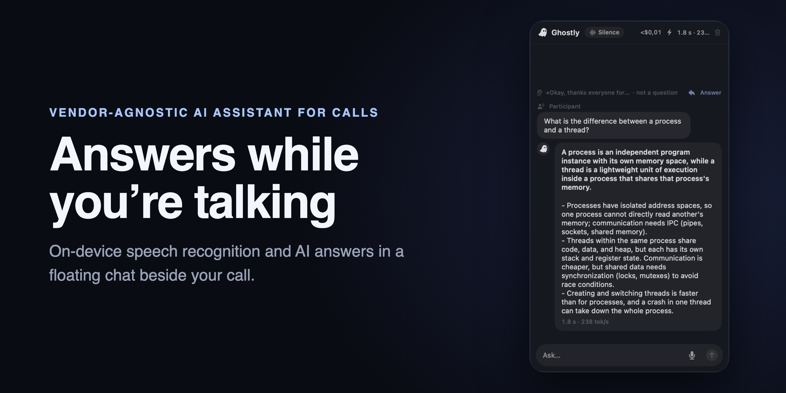
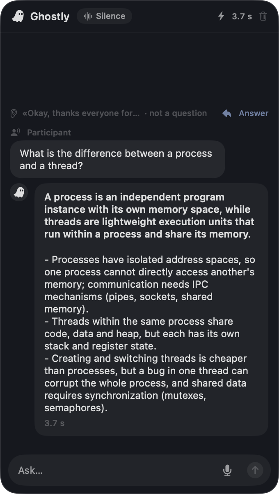
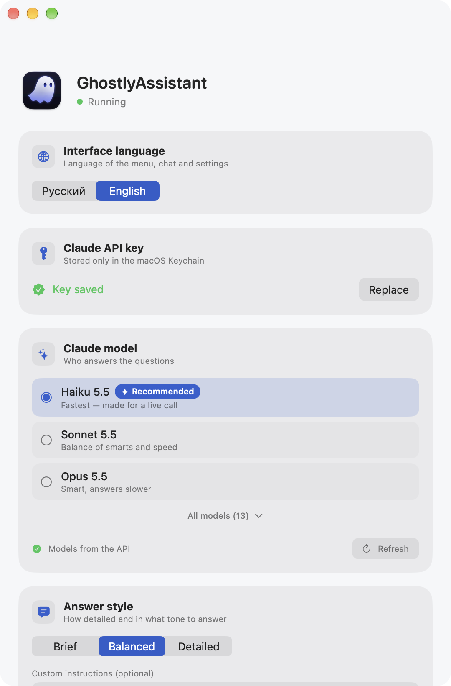

<div align="center">



**English** · [Русский](README.ru.md)

**A vendor-agnostic AI assistant for calls on macOS.** It listens to the call, transcribes speech on-device with Whisper,
notices when someone asks a question and streams the language model's answer into a floating chat that stays out of screen sharing.

</div>

---

## What it is

GhostlyAssistant lives in the macOS menu bar. During a call it:

- **listens to system audio** — what the other people say in Zoom, Meet, Teams and the like;
- **transcribes speech on your Mac** with Whisper (WhisperKit), offline;
- **notices when a question is asked**, takes a screenshot and sends the language model the question, the recent conversation and the image;
- **streams the answer** into a floating chat, in the language the question was asked in;
- **knows your material** — you can attach a knowledge base (PDF, Word, plain text, Markdown, images).

The window carries the macOS "exclude from screen capture" flag, so standard screen-sharing apps don't show it.
This is a public system feature; where it doesn't apply, settings explain how to keep the chat out of the stream
(share a single window or a different display).

## Model providers

GhostlyAssistant is vendor-agnostic: answers come from the language model you choose.

| Provider | Status |
|---|---|
| Anthropic Claude | ✅ supported |
| OpenAI | 🚧 in progress |
| Google Gemini | 🚧 in progress |
| Local models — Ollama, LM Studio, vLLM | 🚧 in progress (OpenAI-compatible API) |

## Screenshots

| Chat during a call — dark theme | Settings — light theme |
|---|---|
|  |  |

## Features

- **Light and dark themes** — minimal, no glass; or follow the system.
- **Live chat** with "Recognizing → Thinking → Answering" stages, and answer latency.
- **Answer a skipped line** — if the assistant decided a line wasn't a question, answer it with a click or `⌥⌘A`.
- **Ask your own question** — typed or spoken into the microphone (the 🎤 button, transcribed by the same Whisper).
- **Knowledge base** — a small one goes into the context whole, a large one is searched with tools (BM25 + opening PDF pages).
- **Model choice** — for Claude the list comes from the Models API for your key.
- **Whisper model choice** — a catalog of 9 variants with download, cancel, switch and delete.
- **Recognition languages** — set separately for the other people on the call and for your own voice.
- **Model parameters** — thinking, effort and maximum answer length; each one is labelled where it affects answer speed.
- **Answer style** — brief / balanced / detailed, plus your own instructions for the prompt.
- **English and Russian interface**, switchable on the fly; text size; launch at login.
- **Hotkeys** — `⌥⌘H` hides/shows the chat, `⌥⌘A` answers the last skipped line.

## How it's built

Logic that can be covered by automated tests lives in the `AssistantCore` Swift package (Swift Testing, 137 tests):
cutting audio into utterances, Claude response types and streaming parser, request building, the assistant pipeline,
the knowledge base and search. The `App/` target holds only what is tied to the OS: audio and screen capture
(ScreenCaptureKit), Whisper, the floating window (AppKit), the interface (SwiftUI) and settings.

Answers go through the Claude Messages API over plain HTTP with SSE parsing — there is no official Swift SDK.

## Install

You need an Apple Silicon Mac on macOS 26+ and your own Claude API key.

1. Download `GhostlyAssistant-<version>.dmg` from [Releases](../../releases) and drag the app into Applications.
2. The build is signed with a developer certificate but not notarized, so on first launch macOS says it can't verify
   the developer. Open **System Settings → Privacy & Security** and click **Open Anyway** — or remove the quarantine
   flag in Terminal:

   ```bash
   xattr -dr com.apple.quarantine /Applications/GhostlyAssistant.app
   ```

Then continue with [First launch](#first-launch).

## Build from source

You need macOS 26+, Xcode 26+ and [XcodeGen](https://github.com/yonaskolb/XcodeGen).

```bash
brew install xcodegen
xcodegen generate
xcodebuild -project GhostlyAssistant.xcodeproj -scheme GhostlyAssistant -configuration Release \
  -derivedDataPath build build
open build/Build/Products/Release/GhostlyAssistant.app
```

The app is signed with an Apple Development certificate — set your own team in `project.yml`
(`DEVELOPMENT_TEAM`), otherwise the screen recording permission is lost after every rebuild.

Core tests:

```bash
swift test --package-path Packages/AssistantCore
```

## First launch

1. 👻 in the menu bar → **Settings…**
2. Paste your **Claude API** key (stored only in the macOS Keychain).
3. Grant **Screen & System Audio Recording** permission and restart the app.
4. On first launch the speech model downloads (~600 MB, compressed Large v3 Turbo by default).

## Debugging

```bash
# transcribe an audio file and print the text with timings
GhostlyAssistant --transcribe path/to/audio.aiff

# run one question through the whole pipeline (key and knowledge base come from settings)
GhostlyAssistant --ask "Question text"
```

## Stack

Swift 6 · SwiftUI + AppKit · ScreenCaptureKit · WhisperKit · PDFKit · Claude Messages API · XcodeGen

---

<div align="center">
<sub>A personal macOS project. Speech recognition and answers run on WhisperKit and the Claude API.</sub>
</div>
