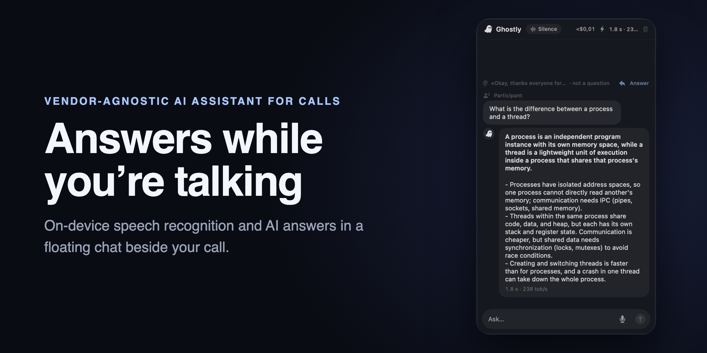
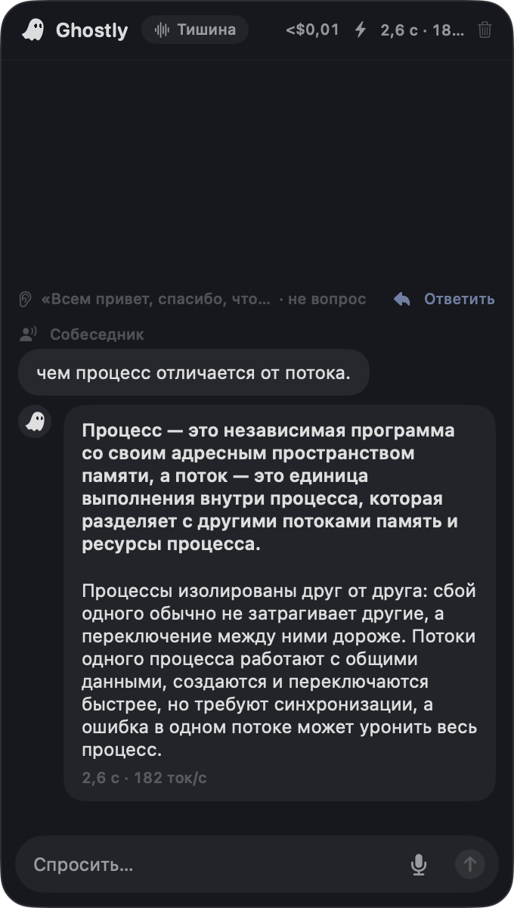
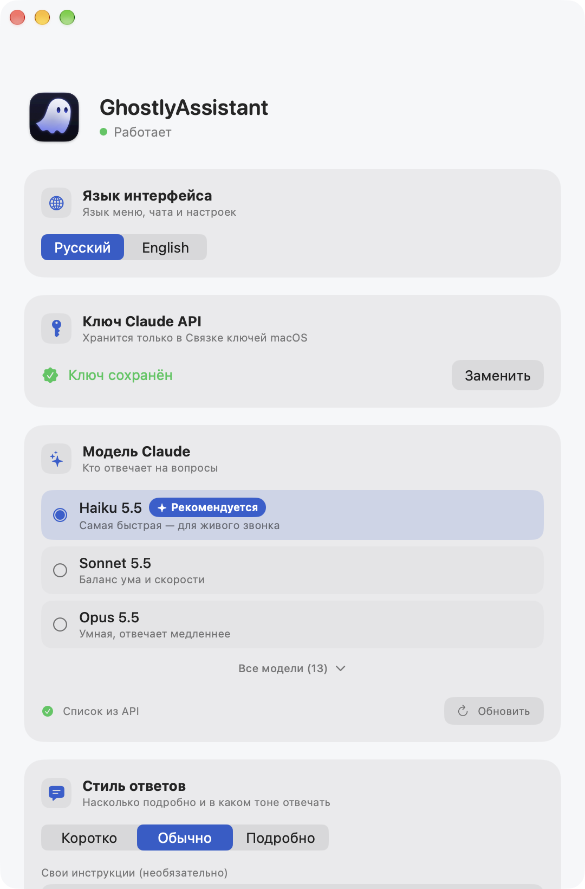
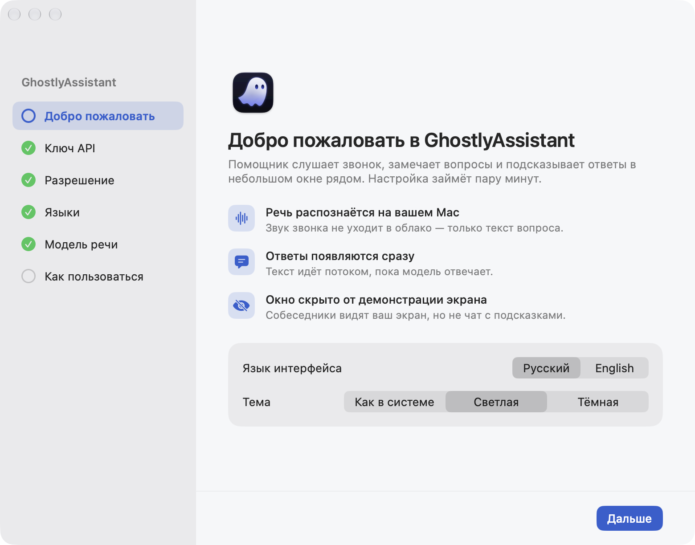

<div align="center">



[English](README.md) · **Русский**

**Vendor-agnostic ИИ-помощник для созвонов на macOS.** Слушает звонок, распознаёт речь локально через Whisper,
сам замечает вопрос и показывает ответ языковой модели в плавающем чате, которого не видно в демонстрации экрана.

</div>

---

## Что это

GhostlyAssistant живёт в строке меню macOS. Во время созвона он:

- **слушает системный звук** — то, что говорят собеседники в Zoom, Meet, Teams и других;
- **распознаёт речь на вашем Mac** через Whisper (WhisperKit), без интернета;
- **сам понимает, что прозвучал вопрос**, делает скриншот экрана и отправляет языковой модели вопрос, недавний кусок разговора и картинку;
- **показывает ответ потоком** в плавающем чате на том языке, на котором спросили;
- **знает ваши материалы** — к нему можно подключить базу знаний (PDF, Word, текст, Markdown, картинки).

Окно помечено флагом macOS «не показывать при захвате экрана», поэтому в стандартных программах
демонстрации его не видно. Это публичная функция системы; где она не срабатывает, в настройках есть
инструкция, как держать чат вне трансляции (демонстрировать отдельное окно или другой дисплей).

## Провайдеры моделей

GhostlyAssistant — vendor-agnostic: ответы строит выбранная вами языковая модель.

| Провайдер | Статус |
|---|---|
| Anthropic Claude | ✅ поддерживается |
| OpenAI | 🚧 в работе |
| Google Gemini | 🚧 в работе |
| Локальные модели — Ollama, LM Studio, vLLM | 🚧 в работе (OpenAI-совместимый API) |

## Как выглядит

| Чат во время звонка — тёмная тема | Настройки — светлая тема |
|---|---|
|  |  |

## Возможности

- **Светлая и тёмная темы** — минималистичные, без стекла; можно выбрать «как в системе».
- **Живой чат** с этапами «Распознаю → Думаю → Отвечаю», и временем ответа.
- **Ответ на пропущенную реплику** — если помощник счёл реплику не вопросом, можно ответить кликом или `⌥⌘A`.
- **Свой вопрос** — текстом или голосом с микрофона (кнопка 🎤, распознаётся тем же Whisper).
- **База знаний** — небольшая целиком уходит в контекст, большая ищется инструментами (BM25 + открытие страниц PDF).
- **Выбор модели** — для Claude список приходит из Models API под ваш ключ.
- **Выбор модели Whisper** — каталог из 9 версий со скачиванием, отменой, переключением и удалением.
- **Языки распознавания** — отдельно для собеседников и для вашего голоса.
- **Параметры модели** — рассуждения, глубина и максимальная длина ответа; у каждой настройки помечено, что она влияет на скорость ответа.
- **Стиль ответов** — коротко / обычно / подробно плюс свои инструкции для промпта.
- **Интерфейс на русском и английском**, переключается на лету; размер текста; автозапуск при входе.
- **Горячие клавиши** — `⌥⌘H` скрыть/показать чат, `⌥⌘A` ответить на последнюю пропущенную реплику.

## Устройство

Логика, которую можно проверить автотестами, вынесена в Swift-пакет `AssistantCore` (Swift Testing, 137 тестов):
нарезка звука на реплики, типы и потоковый разбор ответов Claude, сборка запроса, конвейер помощника,
база знаний и поиск. Приложение `App/` держит только то, что завязано на систему: захват звука и экрана
(ScreenCaptureKit), Whisper, плавающее окно (AppKit), интерфейс (SwiftUI), настройки.

Ответы строятся через Claude Messages API напрямую по HTTP с разбором SSE — официального SDK для Swift нет.

## Требования

| | Минимум |
|---|---|
| Mac | **Apple Silicon (M1 и новее).** Mac на Intel не поддерживаются: приложение собрано только под arm64, а Whisper работает на Neural Engine. |
| macOS | **26 или новее.** |
| Место на диске | ~7 МБ на приложение плюс модель речи: **~630 МБ** у модели по умолчанию, от 77 МБ до 3,1 ГБ в зависимости от выбранной. |
| Интернет | Нужен для ответов (API провайдера модели) и чтобы один раз скачать модель речи. Само распознавание работает без интернета. |
| Провайдер модели | Свой **ключ Claude API**. |
| Разрешения | **Запись экрана и системного звука** (звук звонка и скриншот) и **Микрофон** (только чтобы спрашивать голосом). |

**Какая модель Whisper подойдёт вашему Mac** — по [таблице поддержки argmax](https://huggingface.co/argmaxinc/whisperkit-coreml/blob/main/config.json):

| Модель | Размер | M1 | M2 / M3 / M4 и новее |
|---|---|---|---|
| Large v3 Turbo, сжатая — **по умолчанию** | 627 МБ | ✅ | ✅ |
| Large v3, сжатая | 948 МБ | ✅ | ✅ |
| Large v3 Turbo | 1,6 ГБ | — | ✅ |
| Large v3 | 3,1 ГБ | ✅ | ✅ |
| Small | 486 МБ | ✅ | ✅ |
| Base | 147 МБ | ✅ | ✅ |
| Tiny | 77 МБ | ✅ | ✅ |
| Small, сжатая · Medium | 217 МБ · 1,5 ГБ | нет в таблице argmax — могут работать, не проверено | |

Модель по умолчанию argmax рекомендует для максимальной точности на разных языках, и она работает на любом поддерживаемом Mac.

## Установка

Сначала проверьте [требования](#требования).

1. Скачайте `GhostlyAssistant-<версия>.dmg` из [Releases](../../releases) и перетащите приложение в «Программы».
2. Сборка подписана сертификатом разработчика, но не нотаризована, поэтому при первом запуске macOS
   скажет, что не может проверить разработчика. Откройте **Системные настройки → Конфиденциальность
   и безопасность** и нажмите **«Всё равно открыть»** — или снимите карантин в Терминале:

   ```bash
   xattr -dr com.apple.quarantine /Applications/GhostlyAssistant.app
   ```

Дальше — раздел [«Первый запуск»](#первый-запуск).

## Сборка

Нужны macOS 26+, Xcode 26+ и [XcodeGen](https://github.com/yonaskolb/XcodeGen).

```bash
brew install xcodegen
xcodegen generate
xcodebuild -project GhostlyAssistant.xcodeproj -scheme GhostlyAssistant -configuration Release \
  -derivedDataPath build build
open build/Build/Products/Release/GhostlyAssistant.app
```

Приложение подписывается сертификатом Apple Development — укажите свою команду в `project.yml`
(`DEVELOPMENT_TEAM`), иначе разрешение на запись экрана будет слетать после каждой пересборки.

Установочный DMG (нужен `pip install dmgbuild`): `scripts/make-dmg.sh` → `build/release/GhostlyAssistant-<версия>.dmg`.

Тесты ядра:

```bash
swift test --package-path Packages/AssistantCore
```

## Первый запуск

При первом запуске мастер настройки проведёт через всё по шагам, а чат появится, когда он закончится.



1. **Добро пожаловать** — язык интерфейса и тема; модель распознавания (~600 МБ) начинает скачиваться в фоне.
2. **Ключ Claude API** — проверяется сразу и хранится только в Связке ключей macOS. Можно пропустить и добавить позже.
3. **Запись экрана и звука** — мастер откроет нужный раздел Системных настроек и сам перезапустит приложение.
4. **Языки** — собеседников в звонке и вашего голоса.
5. **Модель речи** — ждёт окончания загрузки, можно выбрать другую модель.
6. **Как пользоваться** — горячие клавиши, микрофон, необязательная база знаний и тестовый вопрос.

Пройти заново: значок в строке меню → **Мастер настройки…**

## Отладка

```bash
# распознать звук из файла и напечатать текст с таймингом
GhostlyAssistant --transcribe path/to/audio.aiff

# прогнать один вопрос через весь конвейер (ключ и база знаний берутся из настроек)
GhostlyAssistant --ask "Текст вопроса"
```

## Стек

Swift 6 · SwiftUI + AppKit · ScreenCaptureKit · WhisperKit · PDFKit · Claude Messages API · XcodeGen

---

<div align="center">
<sub>Пет-проект для macOS. Распознавание речи и ответы работают через WhisperKit и Claude API.</sub>
</div>
